<div align="center">

# 深淵王國 Abyss Kingdom

**在吞噬神祇的深淵邊緣建城、與深淵立約，和全服領主爭奪大陸的 4X 策略 SLG。**

PC 先行（Steam＋自架下載），手機版之後推出 · 一人 + AI 開發 · 開發中（朋友封測準備中）

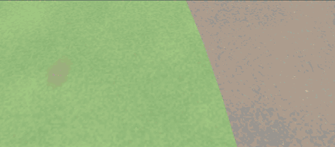

<sub>▲ 新手開場「墜入深淵」（遊戲內即時運鏡，約 32 秒）· <a href="docs/media/intro.mp4">下載有配音的完整版 MP4</a></sub>

</div>

---

**目錄**：[這是什麼遊戲](#這是什麼遊戲) · [遊戲畫面](#遊戲畫面) · [遊戲美術](#遊戲美術) · [目前做到哪裡](#目前做到哪裡) · [技術架構](#技術架構) · [快速開始](#快速開始本機) · [設定](#設定環境變數) · [文件導覽](#文件導覽)

## 這是什麼遊戲

三百年前，大陸中央塌陷，裂開一道看不見底的深淵「**永暗之喉**」。每當一位神祇死去，祂的整個世界便剝落沉入喉中，一層壓著一層，成了神話的地層。

你是新任的**端座領主**：在裂口邊緣築城、與深淵立約取得淵契之力，養成主將、組織聯盟，在同一塊大陸上和其他領主爭奪資源與領地。每個賽季，深淵底下都會翻湧上一層新的神話，帶來不同的魔物與全服巨型 BOSS。

### 三大支柱

| 支柱 | 內容 |
| --- | --- |
| 生存經營 | 城建、居民、主將養成（品質、等級、裝備、升星），對抗深淵低語 |
| 大世界大戰略 | 地表行軍、採集、打怪、攻城；聯盟、集結、援軍、聯盟旗幟與領地 |
| 賽季神話 | 每季翻湧上一層新的神話地層：新的魔物系列與全服合力討伐的巨型 BOSS；主城與主將跨季保留 |

參考作品：王國之歌（Top Heroes）、寒霜啟示錄、萬國覺醒（只參考玩法結構，美術與設定皆原創）。

| | |
|---|---|
| **類型** | 4X / SLG（城建、養成、大地圖、聯盟、PvP） |
| **平台** | Windows 先行；手機版之後 |
| **鏡頭** | 俯視斜角 2.5D，3D 建築與大地圖 |
| **差異化** | 垂直深淵世界觀＋賽季神話、淵脈五行克制與四印養成、城內自由擺放建築 |

## 遊戲畫面

<table>
  <tr>
    <td width="50%">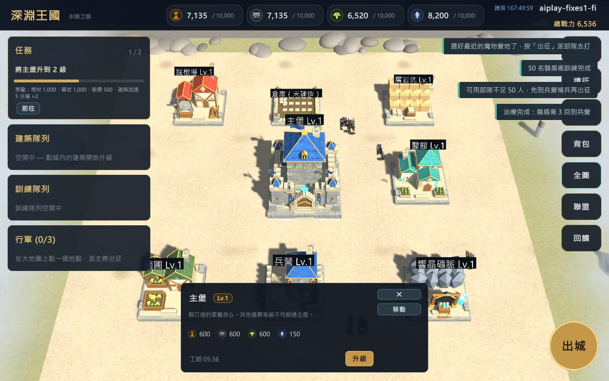<br><b>城內</b>：自由擺放建築，依等級換三種外觀，居民在城裡走動</td>
    <td width="50%">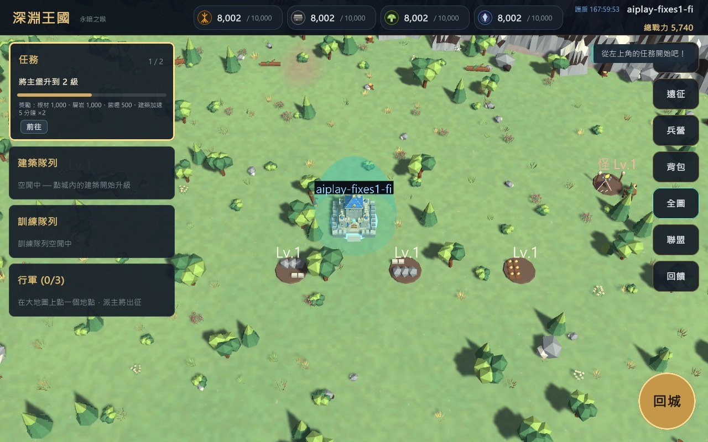<br><b>大地圖</b>：800×800 格的大陸，資源田、魔物營地與各領主主城</td>
  </tr>
  <tr>
    <td>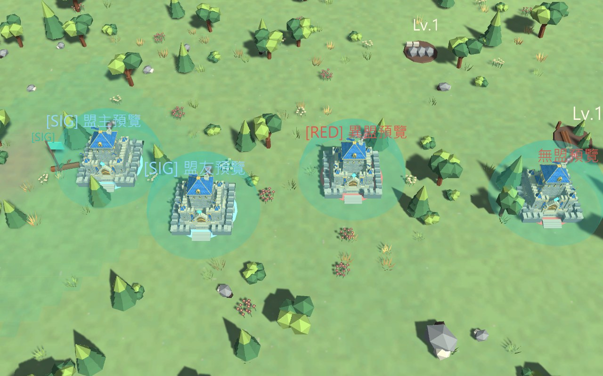<br><b>聯盟</b>：自己與盟友淺藍、敵對紅色，盟旗連成領地</td>
    <td>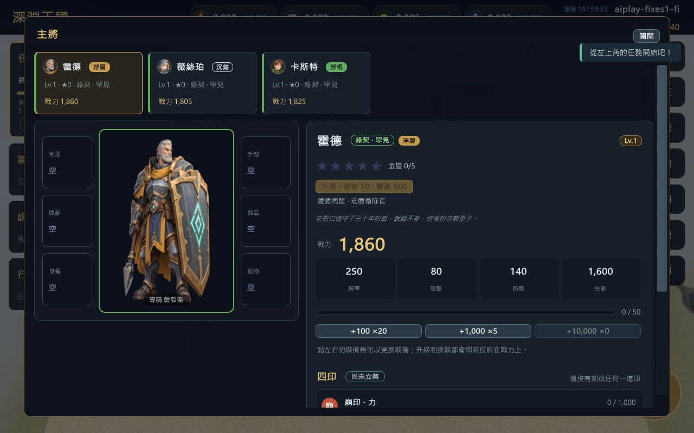<br><b>主將</b>：品質、等級、裝備、升星與四印</td>
  </tr>
  <tr>
    <td>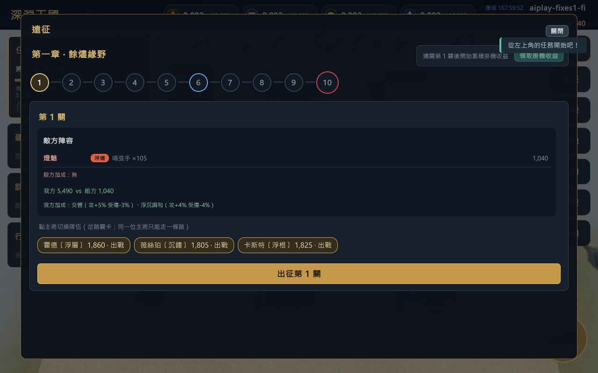<br><b>遠征</b>：分岔路關卡、淵脈克制加成與掛機收益</td>
    <td>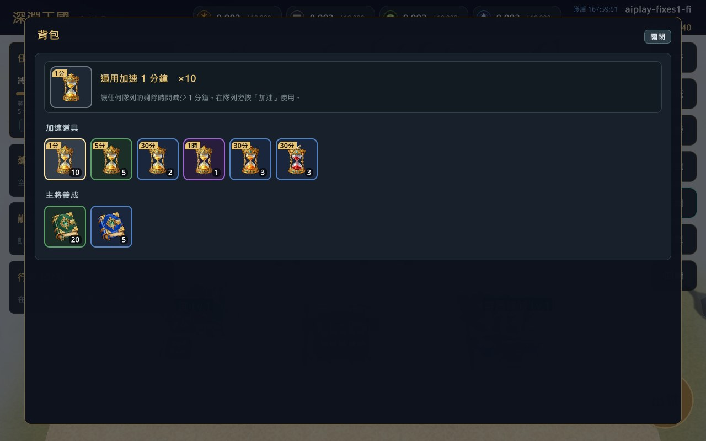<br><b>背包</b>：加速道具與主將養成道具，每個圖示都能點開說明</td>
  </tr>
  <tr>
    <td>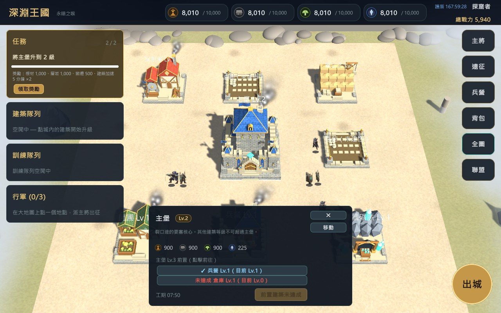<br><b>主堡升級前置</b>：每一級都要先把指定建築升上來</td>
    <td>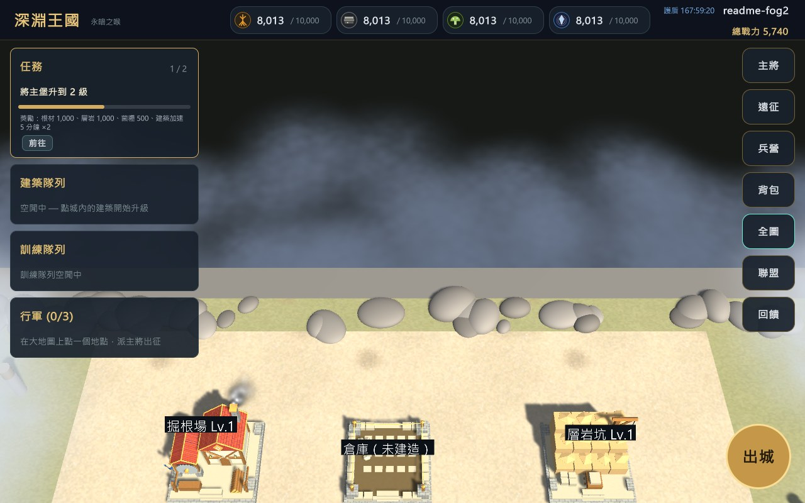<br><b>深淵崖邊</b>：主城北側就是深淵，霧從崖下升起</td>
  </tr>
  <tr>
    <td colspan="2" align="center">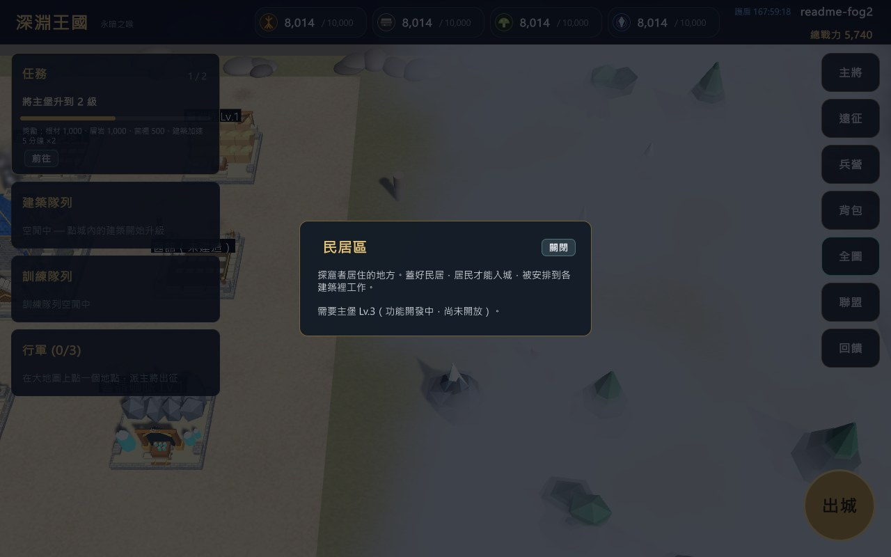<br><b>城外迷霧</b>：主堡升級後逐步驅散，開放民居區、研究區；霧和懸崖都能點開說明</td>
  </tr>
</table>

## 遊戲美術

> 遊戲內實際使用的美術素材（`client/Assets/Resources/Art`），不是實機截圖。

**主將立繪**

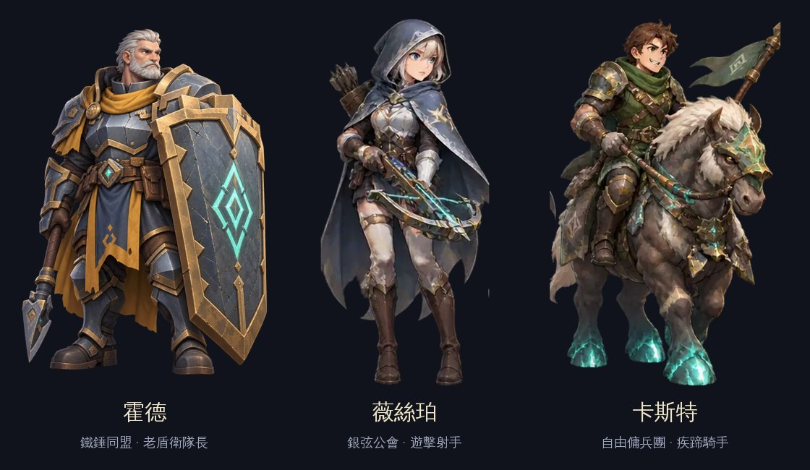

**城內建築**（每種建築依等級有三種外觀）

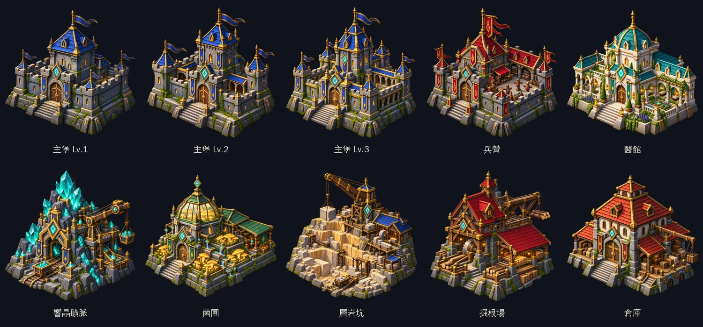

## 目前做到哪裡

| 系統 | 狀態 |
|---|---|
| 城建：8 種建築、升級、訓練、治療、取消與加速、背包、自由擺放 | ✅ |
| 主將：品質、等級、裝備與戰力、升星、四印、淵脈克制 | ✅ |
| 確定性戰鬥核心、遠征第一章、掛機收益 | ✅ |
| 大地圖：行軍、採集、魔物營地、傷兵與醫館、PvP 攻城與掠奪、新手護盾 | ✅ |
| 聯盟：建立／加入、聊天、幫助、混兵援軍、盟旗領地、五人 PvE 集結 | ✅ |
| 新手：開場運鏡與配音、第一章 15 個任務、主堡升級前置 | ✅ |
| 封測工具：遊玩紀錄、錯誤回報、遊戲內回饋、AI 自動試玩 | ✅ |
| 城內迷霧擴張（框架完成，民居區／研究區待功能上線） | 🟨 |
| 研究所、聯盟科技、大使館、居民加成、主將招募 | 規劃中 |
| 深淵潮活動、全服 BOSS、賽季、商城、Steam 上架 | 規劃中 |

完整路線與數值見 [GDD 第 6 節](docs/design/GDD.md)；封測前的待辦見 [封測清單](docs/PLAYTEST_CHECKLIST.md)。

## 技術架構

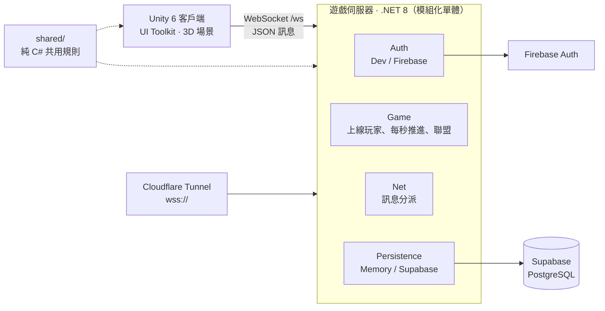

- **伺服器權威**：數值、計時、戰鬥都在伺服器計算；客戶端只送「意圖」，用共用規則做顯示預測。
- **共用規則**：`shared/AbyssKingdom.Shared` 是純 C#（netstandard2.1），伺服器與 Unity 共用同一份程式；只用整數與傳入的時間，戰鬥亂數由伺服器給種子，結果可重現。
- **測試**：自製迷你測試框架（不依賴 NuGet），涵蓋規則、難度曲線、真實 WebSocket 端到端與存檔故障注入，目前 **283 個測試全部通過**；GitHub Actions 每次推送自動跑。
- **AI 試玩**：`tools/AiPlaytest` 用四種玩家角色（照任務走、勤勞、隨便點、離線回來）以真實協定自動玩前 60 分鐘，找出卡關與錯誤。
- **部署**：Docker Compose＋Cloudflare Tunnel（封測前暫用），之後搬到雲端主機。

## 資料夾結構

```
shared/AbyssKingdom.Shared/   共用遊戲規則：City（城建）、Heroes、Battle、Expedition、Map（大地圖）、Social（聯盟）、Protocol
server/AbyssKingdom.Server/   遊戲伺服器：Auth、Game、Net、Persistence、Admin
tests/AbyssKingdom.Tests/     自動測試（不需任何套件）
client/                       Unity 6 專案（Scripts/Game、UI、World、Diagnostics）
tools/                        AiPlaytest（AI 試玩）、NewbieSim（新手節奏模擬）、blender（3D 模型產生）、art、tts
db/                           Supabase 資料表 SQL
art/                          美術原始檔
docs/                         設計文件、交接、部署、封測
```

## 快速開始（本機）

先照 [docs/SETUP.md](docs/SETUP.md) 安裝 .NET 8 SDK 與 Unity 6。

```bash
# 1. 跑測試（全部 PASS 才往下）
dotnet run --project tests/AbyssKingdom.Tests

# 2. 啟動伺服器（預設 http://127.0.0.1:5080，開發模式、記憶體存檔）
dotnet run --project server/AbyssKingdom.Server

# 3. 用 Unity Hub 開啟 client/ 資料夾，按 Play
#    面板出現後輸入名字 → 「連線並登入」
```

## 設定（環境變數）

| 變數 | 說明 | 預設 |
| --- | --- | --- |
| `Auth__Mode` | `Dev`（名字即登入）或 `Firebase` | `Dev` |
| `Firebase__ProjectId` | Firebase 專案 ID（Auth 為 Firebase 時必填） | |
| `Storage__Mode` | `Memory` 或 `Supabase` | `Memory` |
| `Supabase__Url` | 例如 `https://xxxx.supabase.co` | |
| `Supabase__ServiceKey` | Supabase 的 service_role key，**只放在伺服器環境變數** | |
| `Admin__Token` | GM 工具與封測紀錄端點的權杖（至少 24 字元；不設就不開放） | |

正式環境務必設定 `Auth__Mode=Firebase`，否則任何人都能用名字登入別人的帳號。`Auth__Mode`、`Storage__Mode` 填了不認得的值（例如拼錯）伺服器會拒絕啟動，不會默默退回 Dev 或記憶體存檔。

啟用 S6 聯盟前，Supabase 需先套用 `db/002_alliances.sql`；封測紀錄需套用 `db/003_playtest_events.sql`。目前聯盟資料由單一遊戲伺服器序列化寫入；不要以多個遊戲伺服器實例同時提供聯盟寫入。

## 文件導覽

| 文件 | 內容 |
|---|---|
| [docs/design/GDD.md](docs/design/GDD.md) | **設定集**：世界觀、名詞、規則、數值、路線的唯一正式版本 |
| [docs/HANDOFF.md](docs/HANDOFF.md) | 接手開發先讀：專案背景、已定案決策、帳號狀態 |
| [docs/design/S6_ALLIANCE.md](docs/design/S6_ALLIANCE.md) | 聯盟系統細則 |
| [docs/PLAYTEST_CHECKLIST.md](docs/PLAYTEST_CHECKLIST.md) | 朋友封測前清單 |
| [docs/AI_PLAYTEST_REPORT.md](docs/AI_PLAYTEST_REPORT.md) | AI 試玩報告 |
| [docs/DEPLOY.md](docs/DEPLOY.md) | 部署方式 |
| [docs/art/MODEL_SPEC.md](docs/art/MODEL_SPEC.md) | 3D 模型規格 |

## 開發方式

一人 + AI（Vibe Coding）開發：每次只做一個小功能，規則改動一定附測試，設定與數值改動同步寫進 GDD。開發規則見 [CLAUDE.md](CLAUDE.md)。

## 版權與聲明

- 世界觀只借用「垂直深淵探勘」的概念，名詞、角色、造型、劇情與美術皆為原創；神話素材只取結構與概念（詳見 GDD 2.5）。
- 開場旁白為 AI 合成語音（以「雲哲」zh-TW-YunJheNeural 為基礎降調 -15%）。目前的音檔是開發用版本，上架前會以正式授權的 Azure 文字轉語音重新產生。
- 本專案目前未開放授權，保留所有權利。

<details>
<summary><b>連線協定（開發者）</b></summary>

WebSocket `/ws`，每則訊息為 JSON：`{ "type": "...", "reqId": 1, "data": { ... } }`

| 方向 | type | data |
| --- | --- | --- |
| → | `login` | `{ token, displayName }` |
| → | `city.get` | — |
| → | `city.upgrade` | `{ building: "Keep" }` |
| → | `city.train` | `{ troop: "Shield", count: 50 }`（需兵營；單批上限 = 兵營等級 × 50） |
| → | `city.cancel` | `{ queue: "Building" \| "Training" }`（退 50%；訓練已完成的士兵照算） |
| → | `city.speedup` | `{ queue, item?, count? }`（不帶 item = 剩餘 5 分鐘內免費完成；帶 item = 使用加速道具） |
| → | `city.heal` | `{ troops: { "Shield": 30 } }` 治療醫館裡的傷兵（花訓練成本的一半與一半時間；同時一批）；取消／加速用 `city.cancel`／`city.speedup`，queue = `Healing` |
| → | `city.move` | `{ building, x, y }` 把建築移到城內格子（佔地左上角；不可重疊、不可超出 24×24） |
| → | `hero.levelUp` | `{ hero: "Hold", item: "HeroExpSmall", count: 1 }` |
| → | `gear.equip` / `gear.unequip` | `{ gear: <uid>, hero }` / `{ gear: <uid> }` |
| → | `expedition.battle` | `{ stage: 1, teams: [["Hold","Vesper"],["Karst"]] }`（每條岔路一隊） |
| → | `expedition.claimIdle` | —（領掛機收益） |
| → | `domain.useScroll` | `{ hero, item: "DomainScrollPower", count }`（索譜補修練值） |
| → | `domain.trial` | `{ hero, domain: "Power" }`（修練值滿、且對應星色升滿才能挑戰） |
| → | `hero.starUp` | `{ hero }`（消耗信物＋響晶升一顆星） |
| → | `quest.claim` | —（領取目前新手任務的獎勵；成功回 `city.state`，任務進度在 `city.questIndex`、`city.stats`；失敗 `quest_rejected`：`NotDone`／`NoQuest`） |
| → | `alliance.get` | —（列出聯盟及自己的盟籍、成員、可審核申請、創盟待完成操作） |
| → | `alliance.create` | `{ name, tag, operationId }`（`operationId` 是重試時不變的 UUID；主堡 Lv.3、根材／層岩各 5,000） |
| → | `alliance.join` / `alliance.apply` | `{ allianceId }`（主堡 Lv.2；自由加入或審核申請） |
| → | `alliance.review` | `{ playerId, accept }`（盟主／幹部審核申請） |
| → | `alliance.leave` / `alliance.dissolve` | —（離盟或僅剩盟主時解散） |
| → | `alliance.kick` / `alliance.transfer` | `{ playerId }`（踢人／轉讓盟主） |
| → | `alliance.officer` | `{ playerId, officer }`（任免幹部） |
| → | `alliance.joinMode` | `{ mode: "Open" \| "Approval" }` |
| → | `alliance.rally.create` | `{ hero, troops, x, y, seconds: 60\|180\|300, operationId }`（Lv.2／3 營地，最多五人自由混兵；至少兩人到齊） |
| → | `alliance.rally.join` / `alliance.rally.recall` | `{ id, hero, troops, operationId }` / `{ id }`（準備期可退出；出發後僅隊長可整隊召回；結算中不能召回） |
| → | `alliance.flag.place` / `alliance.flag.remove` | `{ slot: 1..3, x, y, operationId }` / `{ slot }`（盟主／幹部；付款重試 UUID 不變；撤旗不退款且槽位冷卻 24 小時） |
| ↔ | `world.territory` | — → `{ flags: [{ id, allianceId, tag, x, y, paid, completesAtMs }] }`（公開領地；生效以伺服器時間為準） |
| → | `alliance.chat.post` / `alliance.chat.history` | `{ operationId, text }` / `{ afterSequence }`（成員聊天，UUID 重試不變） |
| → | `alliance.chat.report` / `alliance.chat.hide` / `alliance.chat.mute` | `{ sequence }` / `{ sequence }` / `{ playerId, hours: 1 \| 24 }` |
| → | `alliance.announcement` | `{ text }`（盟主／幹部公告） |
| → | `alliance.help.request` / `alliance.help.all` | `{ queue: "Building" \| "Healing" }` / — |
| → | `alliance.reinforcement.send` | `{ playerId, hero, troops, operationId }`（一主將混兵，雙方主堡 Lv.3；在途預留唯一席位；UUID 重試不變） |
| → | `alliance.reinforcement.return` / `alliance.reinforcement.accept` | `{ id }`（原主人召回／收援者遣返） / `{ accept }`（只關閉新派遣） |
| ← | `alliance.chat` / `alliance.chat.messages` | `{ allianceId, messages, fullSnapshot, oldestSequence, latestSequence }` |
| ← | `alliance.help.result` / `alliance.help.changed` | `{ applied, expired }` / `{}`（收到變更後重讀聯盟資料） |
| ← | `alliance.military.changed` | `{}`（只推播援軍雙方；重讀 `alliance.get`，援軍狀態在 `reinforcements`） |
| → | `map.march` | `{ hero, troops: { "Rider": 50 }, x, y }`（從主城出征到地表格子 (x, y)；直線行進，跨分區時自動繞經關隘；目標是資源田就採集、怪物營地就開打、別人的主城就攻城（會解除自己的護盾）；狀態在 `city.surface.marches`） |
| → | `map.recall` | `{ march }`（召回行軍，路上或駐紮中都可以；回到主城後部隊歸營） |
| → | `world.tile` | `{ x, y }`（查詢某一格的即時狀態：資源田的存量、誰在採集） |
| → | `world.cities` | —（取得地表所有主城的公開資訊；自己的主城位置在 `city.surface.x / y`） |
| → | `world.camps` | —（取得目前被擊敗、還沒重生的怪物營地） |
| → | `ping` | — |
| ← | `login.ok` | `{ playerId, displayName, serverTimeMs }` |
| ← | `city.state` | `{ serverTimeMs, city }` |
| ← | `city.upgradeCompleted` | `{ building, level }`（伺服器主動推播，reqId = 0） |
| ← | `city.trainingCompleted` | `{ troop, count }`（伺服器主動推播，reqId = 0） |
| ← | `expedition.result` | `{ stage, win, reports: [戰報…], rewards }`，之後再送一次 `city.state` |
| ← | `expedition.idleClaimed` | `{ resources, items }` |
| ← | `domain.trialResult` | `{ hero, domain, success, report }`，之後再送一次 `city.state` |
| ← | `map.marchArrived` | `{ march, hero, tile, disbanded, gathering, occupied, gatherDone, carry, lootItems, battleWon, battleLost, campGone, wounded, dead, shielded, allied, targetName }`（tile = y × 800 + x；抵達、採集、打怪、攻城與同盟無戰鬥折返；伺服器主動推播，reqId = 0） |
| ← | `alliance.state` | `{ version, serverTimeMs, alliances, myAllianceId, myRole, members, applications, rejoinAfterMs, guideProgress, helpRequests, reinforcements, flags, rallies, pendingCreateOperationId, pendingCreateName, pendingCreateTag }`（審核資料只給有權者；操作 UUID 與派兵原配置只給本人；舊版本快照不覆蓋新版本） |
| ← | `world.tile` | `{ x, y, stock, max, occupant, mine, campBackAt }` |
| ← | `city.healingCompleted` | `{ troops }`（治療完成，伺服器主動推播） |
| ← | `city.attacked` | `{ attackerName, defenderWon, wounded, dead, plundered }`（你的主城被攻打，伺服器主動推播） |
| ← | `world.cities` | `{ cities: [{ x, y, name, power, mine, allied, shielded, keepLevel }] }`（`allied` 由伺服器依盟籍判定；自己／同盟淺藍，非同盟紅色，不公開帳號 ID） |
| ← | `world.camps` | `{ camps: [{ x, y, backAt }] }`（`backAt` = 重生時間，伺服器 Unix 毫秒） |
| ← | `error` | `{ code, detail }`（`city.upgrade` 前置不足：`detail = KeepPrerequisiteMissing`，共用 `UpgradeResult` 附加值 6；不扣資源、不新增升級隊列） |
| → | `client.error` | `{ message, stack }`（登入後，訊息 1,200 字、stack 前五行／800 字；每登入二十筆，同訊息六十秒去重；不能上報遊戲事件） |
| → | `feedback.send` | `{ text, screen: "city" / "world" }`（一至一千字；滑動六十秒最多三則，screen 為客戶端畫面資訊，主堡／任務／秒數由伺服器附加） |
| ← | `feedback.received` | `{ accepted }`（reqId 對應回饋；accepted 表示排入背景佇列，資料庫寫入為 best effort） |

封測 GM 均需 `X-Admin-Token`：`GET /admin/playtest/summary`、`events?playerId=<server-player-id>`、`errors`、`feedback`。Supabase 啟用前須人工執行 `db/003_playtest_events.sql`；完整說明見 [交接文件](docs/HANDOFF-PLAYTEST-TELEMETRY.md)。

</details>
