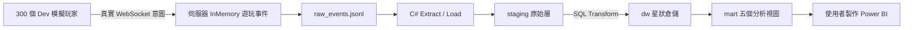

# 封測數據分析第一批（模擬資料）

這是 SQL／ETL／資料倉儲／BI 的履歷作品，**所有成果均為模擬資料，不是真實玩家營運數據**。
Power BI 報表由使用者自己製作；本批完成從玩家協定到 PostgreSQL 分析視圖的管線。



## 本機從零執行

先安裝／啟動 Docker Desktop 與 .NET 8 SDK，在**專案根目錄的 PowerShell** 執行。
不要使用正式 Supabase 的連線資訊。以下不會修改遊戲規則、不會部署。

```powershell
# 帳密只放目前終端的環境變數，不存 .env、程式碼或報告。
$env:ANALYTICS_DB = 'abyss_analytics'
$env:ANALYTICS_USER = 'analytics_owner'
$env:ANALYTICS_PORT = '54329'
$env:ANALYTICS_PASSWORD = [System.Net.NetworkCredential]::new('', (Read-Host 'Local analytics password' -AsSecureString)).Password

docker compose -f analytics/docker-compose.yml up -d --wait

dotnet restore tools/PlaytestEtl --locked-mode
dotnet run --project tools/AiPlaytest -- --population 300 --days 7 --seed 20261020

$env:ANALYTICS_CONNECTION_STRING = "Host=127.0.0.1;Port=$env:ANALYTICS_PORT;Database=$env:ANALYTICS_DB;Username=$env:ANALYTICS_USER;Password=$env:ANALYTICS_PASSWORD"
dotnet run --project tools/PlaytestEtl
dotnet run --project tools/PlaytestEtl --no-build
dotnet run --project tests/AbyssKingdom.Tests
./analytics/verify.ps1
```

密碼若含分號，連線字串的 Password 值需依 Npgsql 格式加引號；本次驗收採環境變數產生的隨機十六進位密碼。
已有本批容器時，PostgreSQL 不會因環境變數改變就重設原密碼；重開終端可將該容器的既有值載入環境，**不要把輸出貼到聊天或報告**：

```powershell
$env:ANALYTICS_PASSWORD = docker exec abyss-analytics-postgres-1 printenv POSTGRES_PASSWORD
$env:ANALYTICS_CONNECTION_STRING = "Host=127.0.0.1;Port=$env:ANALYTICS_PORT;Database=$env:ANALYTICS_DB;Username=$env:ANALYTICS_USER;Password=$env:ANALYTICS_PASSWORD"
```

容器僅映射 `127.0.0.1:54329`。ETL 也會拒絕非 loopback 主機，或名稱不以 `abyss_analytics` 開頭的資料庫。
執行後輸出：

- `analytics/data/raw_events.jsonl`：伺服器實際持久化到 InMemoryPlaytestStore 的事件，保留原始 `id/player_id/kind/at_ms/data`。
- `analytics/data/simulation.json`：種子、版本參數、各玩家角色／回訪率／放棄任務／時長、計畫訪次、實際訪次與觀察截止時間。
- `analytics/data/mart-samples.md`：每個 mart 前十列的實際 SQL 查詢輸出。
- `analytics/data/regression/`：**獨立測試用人工 fixture**，不是模擬玩家原始資料。

`analytics/data/` 已加入 `.gitignore`。不要提交原始事件、manifest、測試資料、資料庫或密碼。
README 末尾的匿名彙總查詢輸出可作為作品證據。
再次「產生」模擬會覆寫匯出檔，但伺服器新 GUID 不同；要驗證 ETL 去重，請對**同一份檔案**連跑兩次。
已有本批資料時，驗收可直接跳過模擬步驟，重跑 ETL、測試與 verify.ps1。若要重新產生整批模擬，請使用新的本機 `abyss_analytics*` 資料庫與獨立輸出目錄；不要將新 GUID 的重播當作既有批次的增量資料。

## 模擬方式與可重現性

`--simulate` 直接使用 300 人／7 日預設；也可指定 `--population N --days D --seed S --start 2026-10-01T00:00:00+08:00 --output <絕對路徑>`。
人口上限 2,000、追蹤日數上限 30，避免無意間跑出超大資料集。
四種角色各自帶不同回訪率、遊玩時長與中途放棄機率；不是把同一位玩家複製 300 次。

- `quest`：照任務走，8～34 分鐘為基準時長，回訪率約 0.68～0.78。
- `diligent`：維持隊列、培養與補兵，25～79 分鐘，回訪率約 0.88～0.98。
- `random`：包含被伺服器合法拒絕的隨意操作，2～24 分鐘，回訪率約 0.42～0.52。
- `offline`：回訪可能一天兩次，12～49 分鐘，回訪率約 0.72～0.82。

每次時長再加 -4～+4 分鐘擾動，最短一分鐘。達到個人的放棄任務門檻時判斷一次永久流失；未永久流失者仍可能缺席某天後再回訪。
第一天分散在七天內。`days=7` 指**首日後追蹤 D1～D7**，連同 D0；因此七天分批入組後，整體有十四個日曆日的觀察窗。
預設開始於台灣 2026-10-01，觀察截止為 2026-10-15 00:00（不包含該日活動）。

所有升級、領獎、訓練、行軍等意圖走既有 WebSocket；沒有 GM 加資源或直接修改玩家狀態。
工具以手動時鐘與明確的伺服器 tick 推進時間，取代牆鐘背景排程；遊戲仍由原伺服器邏輯結算。
WorldService 只新增可注入的選址 Random／戰鬥種子入口，正式預設仍為原選址亂數與密碼學種子；不改戰鬥公式與平衡數值。

同種子、相同 .NET 版本與程式碼，可重現遊玩計畫與業務事件／彙總；**event ID、session ID 為伺服器 GUID，不保證位元組相同**。
本次 8 人與 300 人各重跑一次，排除 GUID／全域 sequence 後核對玩家、種類、時間與業務欄位，差異為零。
`--output` 建議使用絕對路徑，避免 dotnet run 的工具工作目錄影響相對路徑位置。

## 三個 ETL 階段

1. **ExtractAsync**：`JsonlEventSource` 讀 JSONL，檢查必要欄位、JSON 物件與時間範圍，錯誤指出行號。`IRawEventSource` 留給日後 GM HTTP 來源；本批不連正式服務。
2. **LoadStagingAsync**：每 500 筆參數化批次載入，`ON CONFLICT DO NOTHING` 依原始事件 ID 去重。任務種子直接由 shared 的 QuestConfig 與既有 DisplayNames 產生；manifest 另存補充資料，不冒充事件。
3. **TransformAsync**：執行 `03`～`05` SQL，維度按自然鍵合併、事實表完整重算。本作品約兩萬筆，完整重算易解釋，也能修正晚到事件；資料成長時再改受影響玩家／日期的增量重算。

`01` 建 schema、`02` 建表與索引；完成後執行 `90_checks.sql`。**staging 載入、維度、事實與檢查在同一交易**，這些步驟任何失敗都回滾，不發布半套資料。樣本檔在提交後匯出，匯出檔案失敗不會回滾已提交的倉儲。
C# 只負責 I/O、編排、來源欄位對應與 log；遊玩區段、日期、漏斗、留存等轉換全部在 SQL。
每步會印出輸入、插入、重複與各倉儲表筆數。

## 星狀模型與粒度

| 表 | 一列代表 | 主鍵／關聯 |
| --- | --- | --- |
| staging.raw_events | 原始事件 | event_id，對應來源 id |
| dw.dim_player | 玩家 | player_key；自然鍵 player_id，顯示名稱不必唯一 |
| dw.dim_date | 台灣日曆日 | date_key = yyyymmdd；ISO 星期一為 1 |
| dw.dim_quest | 第一章任務 | quest_index **1～15**，不是存檔的 0-based 進度 |
| dw.dim_event_kind | 事件種類 | kind_key，自然鍵 kind |
| dw.fact_event | 玩家一次事件 | event_id，連玩家／日期／種類／可選任務 |
| dw.fact_session | 一次遊玩 | session_id，連玩家／開始日期 |
| dw.fact_player_day | 玩家一天 | player_key＋date_key |

另有 staging.quest_catalog、staging.dataset，分別保存 shared 任務種子與來源／觀察截止補充資訊。
所有外鍵與常用日期、玩家、事件種類、任務、建築與時間篩選欄位有索引。
時間為 UTC 的 timestamptz；日期、cohort、跨午夜分配以 Asia/Taipei 計算。
午夜結束事件仍需 fact_event 與 dim_date 外鍵，因此日期維度可能多一天；**只靠 session.end 不算新一天活躍**。

session 使用累計 session.start 的視窗函數分段，同毫秒以伺服器 sequence 排序，再配同 sessionId 的 end。
沒有 end 時用該段最後事件結束，新增 `end_inferred` 標記；這可能低估真實時間，不把離線時間當遊玩時間。
跨午夜秒數採累計秒數差分分配，包含毫秒邊界也能與 session 總秒數對帳。
逐日 sessions 為碰到該日的遊玩段數，一段跨日可在兩天各計一次；max_quest_index 為截至當日已領取任務的累計最高編號。

## 五個分析視圖與指標定義

| 視圖 | 定義與注意事項 |
| --- | --- |
| mart.quest_funnel | 已被伺服器驗證且領獎的人數；第一項分母為全體玩家，其後分母為前一任務人數。無法觀測達成但未領獎者 |
| mart.retention | D1／D3／D7「當日有活動」，不是連續回訪或 rolling retention。完整觀察到目標日結束才入分母；不足為 NULL |
| mart.daily_activity | 每日事件活動或跨日遊玩者 DAU；平均時間＝當日活躍秒數／DAU；補齊零活動日 |
| mart.session_length_buckets | 左閉右開：0～<5、5～<15、15～<30、30～<60、≥60 分鐘；300 秒在第二組 |
| mart.persona_summary | 每種模擬角色每人的**整段觀察窗總遊玩時間平均**，以及已領完第一章的比例 |

比率 0～1，Power BI 設為百分比。D7 可高於 D1：玩家某天沒回來，之後仍可回訪。
每個 mart 都有 `is_simulated`，不可將本次結果描述為真實留存率。

## 品質與重跑驗證

`90_checks.sql` 檢查事件對帳、事實外鍵、非負秒數、session 不重疊、開始事件與 session 對帳、跨日秒數對帳、任務領獎對帳／無跳號，以及留存範圍。
缺少任務歷史的部分匯出可能觸發跳號檢查；應先補齊來源歷史，不靜默丟棄事件。
`92_snapshot.sql` 比較八張表的筆數和整列內容雜湊；serial 序號可能因 upsert 有間隙，但既有代理鍵及內容不變。
`verify.ps1` 建立獨立 `abyss_analytics_fixture`，驗證九項邊界與失敗交易回滾，不混進主資料集。

本次 2026-10-20 實測：

- 300 位模擬玩家、1,757 次遊玩、18,681 筆事件、30,988 次遊玩意圖；836 次伺服器拒絕屬隨意操作等預期情境。
- ETL 第二次插入 **0** 筆；八張表的筆數與內容雜湊相同。
- 11 項資料品質檢查全 PASS；9 項 SQL 邊界／回滾檢查全 PASS；一般測試 **287 passed，0 failed**。
- PostgreSQL **16.15**；Npgsql **10.0.3**，有鎖定套件檔。只有 ETL 使用 NuGet，測試專案沒有新增 NuGet 相依。
- 證據在 artifacts/analytics-*.log、analytics-before.txt／analytics-after.txt、analytics-reproduction300.txt。

## 本次模擬分析示範（不能推論真實玩家）

第一章有 187／300 人領完，完成率 62.33%。最大的任務落差在 #6 採集：275 →237 人，少 38 人，相鄰步驟留存 86.18%。
這示範漏斗如何定位待研究的步驟；由於放棄行為與時長是人工參數，**不是採集設計造成真實流失的證據**。
四角色的完成率與平均時間有明顯差異，正是用來練習分群與 cohort 分析的模擬輸入。

## Power BI 連線步驟（使用者製作）

1. 保持本機 PostgreSQL 容器運行，開 Power BI Desktop → 取得資料 → PostgreSQL 資料庫。
2. 伺服器填 `127.0.0.1:54329`，資料庫 `abyss_analytics`，使用目前本機環境設定的帳密；不要用 Supabase 金鑰。
3. 選匯入模式，導覽勾選 mart 的五個視圖。不同粒度視圖可各自做圖，勿直接互相 join 造成重複彙總。
4. 日期欄設日期；retention／share／completion_rate 設百分比；秒數可除 60 顯示分鐘。
5. 建議做任務漏斗、每日 DAU 折線、cohort 留存矩陣、遊玩時長分布、角色完成率長條圖；頁面醒目標示「模擬資料」。
6. 重新產生並 ETL 後，在 Power BI 按重新整理。本批不提供 pbix，以便使用者自己理解並說明報表。

停止本批資料庫用 `docker compose -f analytics/docker-compose.yml stop`，會保留本機 volume；不需要重設 Docker 或刪除 volume。

## 技術參考

- [Npgsql 參數、批次與交易](https://www.npgsql.org/doc/basic-usage.html)
- [Npgsql 10.0.3 套件與 .NET 8 支援](https://www.nuget.org/packages/Npgsql/10.0.3)
- [PostgreSQL 16 視窗函數](https://www.postgresql.org/docs/16/functions-window.html)
- [PostgreSQL 時間與時區函數](https://www.postgresql.org/docs/16/functions-datetime.html)

## 每個 mart 前十列：實際輸出

以下由本機查詢結果附入，非手寫樣本；不足十列的視圖全部列出。

## mart.quest_funnel

|quest_index|quest_title|players_reached|previous_players|step_retention|players_lost|is_simulated|
|---|---|---|---|---|---|---|
|1|將主堡升到 2 級|299|300|0.9967|1|True|
|2|建造兵營|298|299|0.9967|1|True|
|3|累計訓練 50 名士兵|284|298|0.9530|14|True|
|4|將掘根場升到 2 級|275|284|0.9683|9|True|
|5|將菌圃升到 2 級|275|275|1.0000|0|True|
|6|派部隊到資源田採集一次|237|275|0.8618|38|True|
|7|建造倉庫|237|237|1.0000|0|True|
|8|建造醫館|232|237|0.9789|5|True|
|9|擊敗一座魔物營地|226|232|0.9741|6|True|
|10|任一主將升到 5 級|213|226|0.9425|13|True|

## mart.retention

|cohort_date|cohort_players|d1_eligible_players|d1_retained_players|d1_retention|d3_eligible_players|d3_retained_players|d3_retention|d7_eligible_players|d7_retained_players|d7_retention|is_simulated|
|---|---|---|---|---|---|---|---|---|---|---|---|
|2026-10-01|35|35|24|0.6857|35|24|0.6857|35|23|0.6571|True|
|2026-10-02|34|34|19|0.5588|34|21|0.6176|34|19|0.5588|True|
|2026-10-03|40|40|21|0.5250|40|22|0.5500|40|19|0.4750|True|
|2026-10-04|53|53|27|0.5094|53|29|0.5472|53|22|0.4151|True|
|2026-10-05|40|40|26|0.6500|40|23|0.5750|40|27|0.6750|True|
|2026-10-06|52|52|28|0.5385|52|23|0.4423|52|24|0.4615|True|
|2026-10-07|46|46|29|0.6304|46|24|0.5217|46|23|0.5000|True|

## mart.daily_activity

|full_date|dau|avg_play_seconds|new_players|total_active_seconds|is_simulated|
|---|---|---|---|---|---|
|2026-10-01|35|1402.29|35|49080|True|
|2026-10-02|58|1740.52|34|100950|True|
|2026-10-03|75|1994.40|40|149580|True|
|2026-10-04|122|1985.90|53|242280|True|
|2026-10-05|134|2231.19|40|298980|True|
|2026-10-06|170|2064.35|52|350940|True|
|2026-10-07|190|2157.79|46|409980|True|
|2026-10-08|165|2372.73|0|391500|True|
|2026-10-09|138|2519.13|0|347640|True|
|2026-10-10|127|2387.72|0|303240|True|

## mart.session_length_buckets

|bucket_order|minutes|sessions|share|is_simulated|
|---|---|---|---|---|
|1|0-5|77|0.0438|True|
|2|5-15|238|0.1355|True|
|3|15-30|610|0.3472|True|
|4|30-60|699|0.3978|True|
|5|60+|133|0.0757|True|

## mart.persona_summary

|persona|players|avg_play_seconds|chapter_completed_players|chapter_completion_rate|is_simulated|
|---|---|---|---|---|---|
|diligent|75|18144.40|54|0.7200|True|
|offline|75|17036.00|55|0.7333|True|
|quest|75|5797.20|52|0.6933|True|
|random|75|2075.20|26|0.3467|True|

